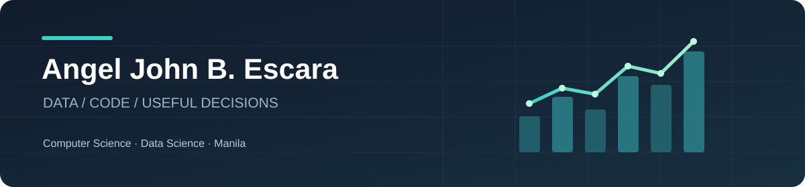

### Computer Science student · Data Science specialization · Manila, Philippines

I build data projects that start with a real question, show the work, and make the result understandable.

[Projects](#selected-work) · [What I use](#what-i-use) · [Connect](#connect)

---

### About me

I'm **Angel John B. Escara**, a BS Computer Science student at **FEU Institute of Technology**, specializing in Data Science (expected graduation: July 2028). I'm a **DOST Merit Scholar** and **FEU Tech President's Scholar**.

I'm looking for a **data analytics or data science internship** where I can work with SQL, Python, data quality, analysis, and clear communication. My recent projects explore customer return behavior and e-commerce sales reporting.

### Selected work

| Project | Question and approach |
| --- | --- |
| **[Customer Retention Tool](https://github.com/abescara/customer-retention-tool)** | Which customers are less likely to purchase again within 90 days? Cleans transaction data, compares a recency baseline with logistic regression, and presents a review list in Streamlit. |
| **[E-commerce Sales Performance Analysis](https://github.com/abescara/E-commerce-Sales-and-Customer-Analytics-Dashboard)** | How do monthly sales and category contributions change? Validates a saved BigQuery export, analyzes it in Python, and presents an interactive Streamlit dashboard. |
| **[WalkIt](https://github.com/abescara/WalkIt)** | An offline Kotlin Android prototype for pedestrian hazard reporting and route awareness. |

### What I use

`Python` · `SQL` · `pandas` · `scikit-learn` · `Streamlit` · `Matplotlib` · `Git` · `GitHub`

I care about documenting data assumptions, checking for leakage, comparing against a simple baseline, and explaining what a result **does and does not** show.

### Connect

[LinkedIn](https://www.linkedin.com/in/angel-john-escara-6baa87380/) · [Explore my repositories](https://github.com/abescara?tab=repositories)

Portfolio projects are educational work. See each repository for data sources, methods, and limitations.
